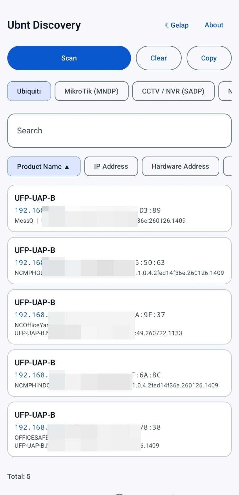
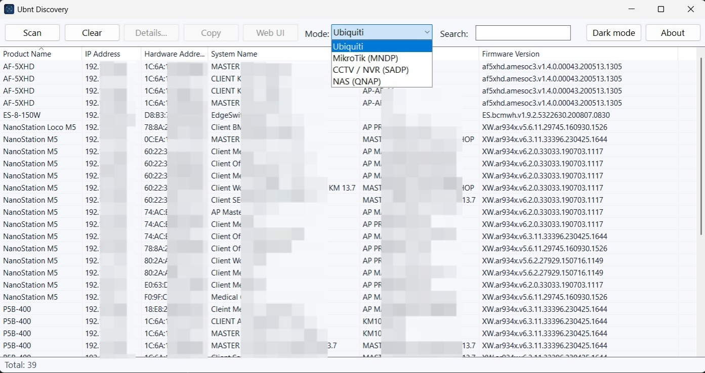

<p align="center">
  
</p>

<h1 align="center">Ubnt Discovery</h1>

Tool *discovery* perangkat jaringan untuk Windows 10/11 dalam **satu file `.exe` portabel**.
Memindai jaringan lokal dan menampilkan perangkat **Ubiquiti** (airOS / UniFi / EdgeMax),
**MikroTik**, kamera/NVR **Hikvision**, dan NAS **QNAP** —
**tanpa Java, tanpa .NET, tanpa installer**.

> ## Rewrite ke Rust dari Ubiquiti Discovery Tool
>
> Proyek ini adalah **penulisan ulang (rewrite) dalam Rust** dari
> *Ubiquiti Discovery Tool* v2.5.1 (`ubnt-discovery-v2.5.1.jar`) milik Ubiquiti Inc.
> Aplikasi aslinya berbentuk `.jar` yang butuh Java; versi ini berjalan native
> sebagai satu `.exe` sekitar **0,4 MB**.
>
> - Tidak ada kode, aset, atau berkas `.jar` Ubiquiti di repo ini.
> - Protokol discovery (UDP broadcast port 10001, reply berformat TLV) dan tabel
>   114 kode model → nama produk dipelajari dari analisis aplikasi asli demi
>   interoperabilitas, lalu ditulis ulang dari nol.
> - Proyek tidak resmi dan tidak berafiliasi dengan Ubiquiti (lihat [Disclaimer](#disclaimer)).

Ditulis dengan [native-windows-gui](https://crates.io/crates/native-windows-gui)
(kontrol Win32 asli). Di-link statis terhadap C runtime, hanya bergantung pada DLL
bawaan Windows.

## Screenshot

<p align="center">
  
  <br>
  
</p>

## Fitur

- **Mode deteksi** — pilih protokol lewat dropdown **Mode**. Mengganti mode langsung
  memulai scan baru:

  | Mode | Setara | Protokol |
  |---|---|---|
  | Ubiquiti | Ubiquiti Discovery Tool | UDP broadcast 10001 |
  | MikroTik (MNDP) | WinBox → Neighbors | UDP broadcast 5678 |
  | CCTV / NVR (SADP) | SADP Tool (Hikvision) | UDP multicast 239.255.255.250:37020 |
  | NAS (QNAP) | Qfinder Pro | UDP broadcast 8097 |

- **Scan** — kirim probe mode aktif di setiap interface IPv4 aktif, lalu tampilkan
  balasan. Scan pertama **otomatis mulai 4 detik** setelah aplikasi dibuka; klik
  **Scan** untuk memulai lebih cepat.
- Tabel perangkat dengan enam kolom (judulnya mengikuti mode): produk/model, IP, MAC,
  nama/identity/serial, SSID/platform/status, dan versi firmware. Klik header kolom
  untuk mengurutkan.
- **Details…** — field per perangkat beserta semua alamat jaringan yang dilaporkan.
- **Copy** — menyalin baris terpilih (dipisah tab).
- **Web UI** — membuka `http://<ip-perangkat>` di browser default (memakai port yang
  dilaporkan perangkat; QNAP 8080).
- Filter **Search** dan **Total** perangkat secara langsung.
- **About** — versi, tautan repo GitHub, dan lisensi.

> **Reboot** dan **SSH tunnel** dari aplikasi asli sengaja tidak disertakan —
> keduanya butuh kredensial perangkat dan autentikasi challenge-response.

## Unduh & jalankan

Ambil `UbntDiscovery.exe` terbaru dari halaman
[Releases](https://github.com/galiehneh/ubnt-discovery/releases), lalu jalankan.
Tidak perlu instalasi atau runtime; boleh disalin ke mana saja (misalnya flashdisk).

Jika Windows Firewall bertanya saat scan pertama, izinkan UDP agar balasan perangkat
dapat diterima.

## Build dari source

Butuh toolchain Rust (`stable-x86_64-pc-windows-msvc`) dan Visual Studio Build Tools
(linker MSVC).

```powershell
cargo test                                    # unit test
cargo clippy --all-targets -- -D warnings     # lint
cargo build --release                         # -> target\release\UbntDiscovery.exe
```

Untuk Windows ARM64: `rustup target add aarch64-pc-windows-msvc` lalu
`cargo build --release --target aarch64-pc-windows-msvc`.

### Android

Prasyarat: Android SDK + NDK 27, JDK 17, `rustup target add aarch64-linux-android armv7-linux-androideabi`, `cargo install cargo-ndk`.
Salin `android/signing/release-signing.properties.example` ke `release-signing.properties` dan isi keystore Anda (tidak masuk git), lalu:

```bash
cd android && ./gradlew assembleRelease
```

## Struktur proyek

```
src/protocol/  client (scan UDP), mode (daftar mode), tlv (Ubiquiti), mndp (MikroTik),
               sadp (Hikvision), qnap (QNAP), device, model_names, request
src/ui/        main_window, details_window, about_window, model (logika UI murni, ter-unit-test)
resources/     app.ico, avatar.png, app.manifest (comctl32 v6, DPI per-monitor)
build.rs       menyematkan ikon, manifest, dan version info
```

## Catatan protokol

Setiap mode memakai protokol vendornya sendiri. Semua parser bersifat defensif: tag tak
dikenal dilewati, dan paket rusak/terpotong tidak pernah menyebabkan panic.

- **Ubiquiti** — UDP broadcast ke port **10001**. Balasan berupa header 4 byte diikuti
  record TLV (`type`, panjang 2 byte, nilai).
- **MikroTik (MNDP)** — probe 4 byte nol ke UDP **5678**. Balasan: header 4 byte lalu TLV
  (`type` 2 byte, panjang 2 byte, nilai) berisi MAC, identity, versi, platform, uptime,
  board, dan IPv4.
- **Hikvision (SADP)** — probe XML `<Probe>` ke multicast **239.255.255.250:37020**;
  perangkat membalas dokumen XML `<ProbeMatch>` (model, serial, MAC, IP, versi, port HTTP,
  status aktivasi).
- **QNAP** — probe 16 byte ke UDP **8097**. Balasan: header 16 byte (MAC NAS dan penanda
  `Se`) diikuti record `tag, panjang, data` (tag `0xCA` untuk record yang diperluas) berisi
  nama server, model, IP, port web, tanggal dan nomor build. Balasan broadcast tidak memuat
  nomor versi bertitik, sehingga kolom firmware menampilkan tanggal + nomor build.

Format MNDP, SADP, dan QNAP dipelajari dari dokumentasi/capture publik dan dari balasan
perangkat nyata, lalu ditulis ulang dari nol. Mode non-Ubiquiti baru ada di aplikasi
Windows; aplikasi Android masih hanya mendeteksi Ubiquiti.

## Versi

Penomoran berbasis tanggal: `vTAHUN.BULAN.TANGGAL` (contoh `v2026.10.17`), dengan
sufiks `.N` bila ada beberapa rilis di hari yang sama.

## Disclaimer

Ubiquiti, UniFi, airOS, dan EdgeMAX adalah merek dagang Ubiquiti Inc.; MikroTik dan
WinBox milik SIA Mikrotikls; Hikvision dan SADP milik Hangzhou Hikvision Digital
Technology Co., Ltd.; QNAP dan Qfinder milik QNAP Systems, Inc. Proyek ini tidak resmi,
tidak berafiliasi, tidak disponsori, dan tidak didukung oleh pemilik merek mana pun.
Nama-nama tersebut hanya dipakai untuk menjelaskan perangkat yang kompatibel.
Software disediakan "apa adanya", tanpa jaminan apa pun.

## Lisensi

Dilisensikan di bawah salah satu dari:

- Apache License, Version 2.0 ([LICENSE-APACHE](LICENSE-APACHE))
- MIT license ([LICENSE-MIT](LICENSE-MIT))

sesuai pilihan Anda.

Kontribusi yang Anda kirimkan dengan sengaja untuk disertakan dalam proyek ini,
sebagaimana didefinisikan dalam lisensi Apache-2.0, akan berlisensi ganda seperti di
atas, tanpa syarat tambahan apa pun.
