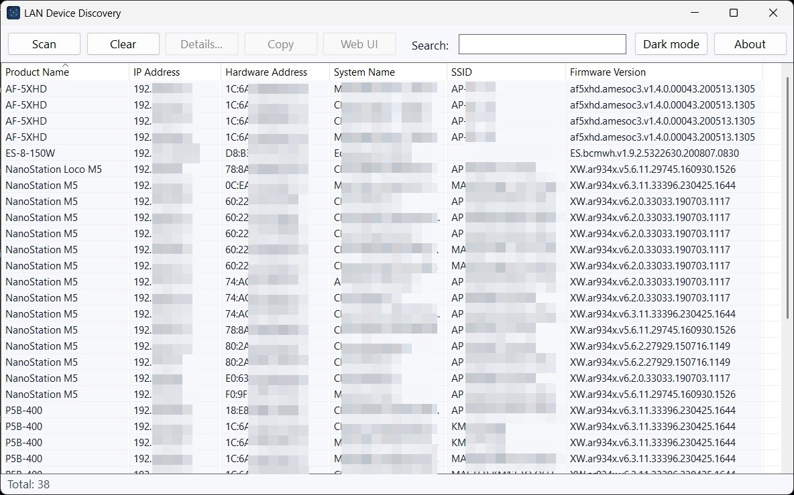
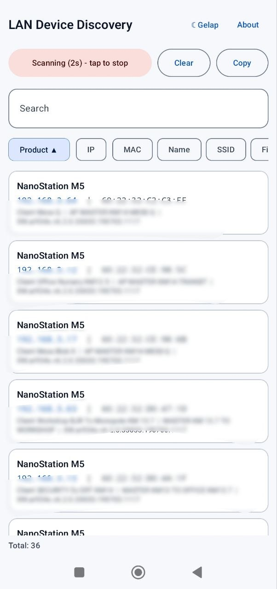

<p align="center">
  
</p>

<h1 align="center">LAN Device Discovery</h1>

Tool *discovery* perangkat Ubiquiti untuk Windows 10/11 dalam **satu file `.exe` portabel**.
Memindai jaringan lokal dan menampilkan perangkat airOS / UniFi / EdgeMax —
**tanpa Java, tanpa .NET, tanpa installer**.

> ## Rewrite ke Rust dari Ubiquiti Discovery Tool
>
> Proyek ini adalah **penulisan ulang (rewrite) dalam Rust** dari
> *Ubiquiti Discovery Tool* v2.5.1 (`ubnt-discovery-v2.5.1.jar`) milik Ubiquiti Inc.
> Aplikasi aslinya berbentuk `.jar` yang butuh Java; versi ini berjalan native
> sebagai satu `.exe` sekitar **0,4 MB**.
>
> - Tidak ada kode, aset, atau berkas `.jar` Ubiquiti di repo ini.
> - Protokol discovery (UDP broadcast port 10001, reply berformat TLV) dan tabel
>   114 kode model → nama produk dipelajari dari analisis aplikasi asli demi
>   interoperabilitas, lalu ditulis ulang dari nol.
> - Proyek tidak resmi dan tidak berafiliasi dengan Ubiquiti (lihat [Disclaimer](#disclaimer)).

Ditulis dengan [native-windows-gui](https://crates.io/crates/native-windows-gui)
(kontrol Win32 asli). Di-link statis terhadap C runtime, hanya bergantung pada DLL
bawaan Windows.

## Screenshot

<p align="center">
  
  
</p>

## Fitur

- **Scan** — broadcast probe discovery Ubiquiti (UDP 10001) di setiap interface
  IPv4 aktif, lalu menampilkan balasan. Scan **otomatis mulai 4 detik** setelah
  aplikasi dibuka; klik **Scan** untuk memulai lebih cepat.
- Tabel perangkat: Product Name, IP Address, Hardware Address (MAC), System Name,
  SSID, Firmware Version. Klik header kolom untuk mengurutkan.
- **Details…** — field per perangkat beserta semua alamat jaringan yang dilaporkan.
- **Copy** — menyalin baris terpilih (dipisah tab).
- **Web UI** — membuka `http://<ip-perangkat>` di browser default.
- Filter **Search** dan **Total** perangkat secara langsung.
- **About** — versi, tautan repo GitHub, dan lisensi.

> **Reboot** dan **SSH tunnel** dari aplikasi asli sengaja tidak disertakan —
> keduanya butuh kredensial perangkat dan autentikasi challenge-response.

## Unduh & jalankan

Ambil `UbntDiscovery-vYYYY.M.D.exe` terbaru dari halaman
[Releases](https://github.com/galiehneh/ubnt-discovery/releases), lalu jalankan.
Tidak perlu instalasi atau runtime; boleh disalin ke mana saja (misalnya flashdisk).

Jika Windows Firewall bertanya saat scan pertama, izinkan UDP agar balasan perangkat
dapat diterima.

## Build dari source

Butuh toolchain Rust (`stable-x86_64-pc-windows-msvc`) dan Visual Studio Build Tools
(linker MSVC).

```powershell
cargo test                                    # unit test
cargo clippy --all-targets -- -D warnings     # lint
cargo build --release                         # -> target\release\UbntDiscovery.exe
```

Untuk Windows ARM64: `rustup target add aarch64-pc-windows-msvc` lalu
`cargo build --release --target aarch64-pc-windows-msvc`.

### Android

Prasyarat: Android SDK + NDK 27, JDK 17, `rustup target add aarch64-linux-android armv7-linux-androideabi`, `cargo install cargo-ndk`.
Salin `android/signing/release-signing.properties.example` ke `release-signing.properties` dan isi keystore Anda (tidak masuk git), lalu:

```bash
cd android && ./gradlew assembleRelease
```

## Struktur proyek

```
src/protocol/  client (scan UDP), tlv (parser reply), device, model_names, request
src/ui/        main_window, details_window, about_window, model (logika UI murni, ter-unit-test)
resources/     app.ico, avatar.png, app.manifest (comctl32 v6, DPI per-monitor)
build.rs       menyematkan ikon, manifest, dan version info
```

## Catatan protokol

Pertukaran discovery adalah UDP broadcast ke port **10001**. Balasan berupa header
4 byte diikuti record TLV (`type`, panjang 2 byte, nilai). Parser bersifat defensif:
tag tak dikenal dilewati, dan paket rusak/terpotong tidak pernah menyebabkan panic.

## Versi

Penomoran berbasis tanggal: `vTAHUN.BULAN.TANGGAL` (contoh `v2026.10.17`), dengan
sufiks `.N` bila ada beberapa rilis di hari yang sama.

## Disclaimer

Ubiquiti, UniFi, airOS, dan EdgeMAX adalah merek dagang Ubiquiti Inc. Proyek ini
tidak resmi, tidak berafiliasi, tidak disponsori, dan tidak didukung oleh Ubiquiti
Inc. Nama-nama tersebut hanya dipakai untuk menjelaskan perangkat yang kompatibel.
Software disediakan "apa adanya", tanpa jaminan apa pun.

## Lisensi

Dilisensikan di bawah salah satu dari:

- Apache License, Version 2.0 ([LICENSE-APACHE](LICENSE-APACHE))
- MIT license ([LICENSE-MIT](LICENSE-MIT))

sesuai pilihan Anda.

Kontribusi yang Anda kirimkan dengan sengaja untuk disertakan dalam proyek ini,
sebagaimana didefinisikan dalam lisensi Apache-2.0, akan berlisensi ganda seperti di
atas, tanpa syarat tambahan apa pun.
